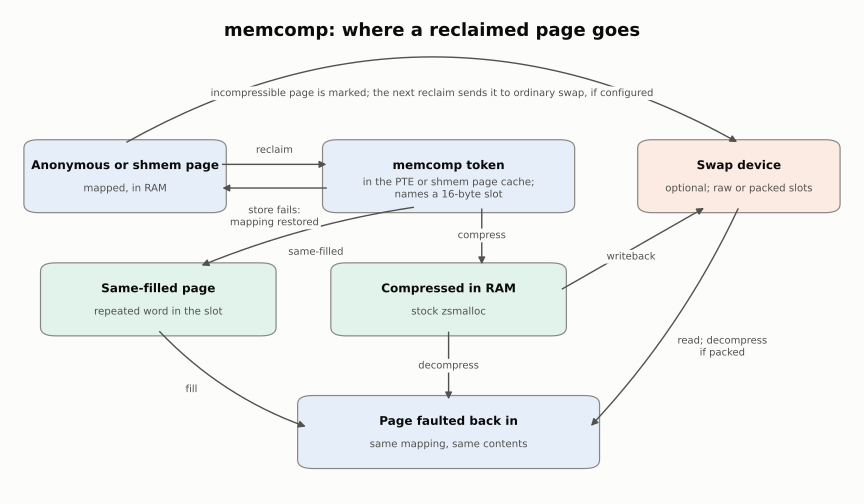
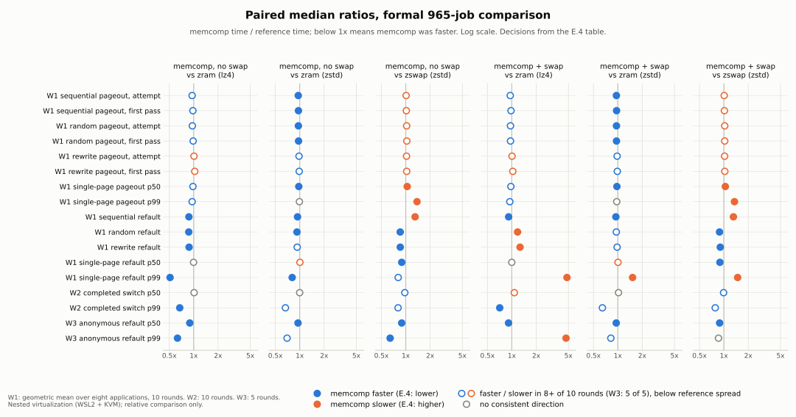
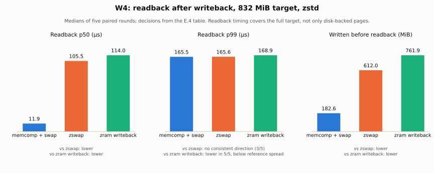

<!-- SPDX-License-Identifier: GPL-2.0-only OR CC-BY-4.0 -->
# memcomp：一种新的 Linux 内存压缩后端

memcomp 是基于 Linux 6.12.23 的一组 RFC 补丁（系列 v1）。内核回收匿名页和 shmem 页时，memcomp 把页压缩后存放在内存里，并在页表中换上一个指向压缩数据的 token。进程再次访问时触发缺页，内核解压数据并重新映射。memcomp 直接使用内核自带的压缩算法和 zsmalloc，不需要块设备。配置了交换区时，冷数据还可以写到盘上。

*图 1：memcomp 的存储与读回路径。*

## 和 zram、zswap 的区别

zram 把压缩内存做成一个块设备，交换子系统照常往里写。zswap 是交换区前面的一层缓存，每个条目都对应交换设备上的一个槽位。memcomp 的 token 不属于任何交换设备：同一个 token 先指向内存里的压缩数据，写回以后改为指向盘上的槽位，页表不需要修改。写回时，多份压缩数据可以合并写进同一个交换页。

每个压缩页的元数据是一个 16 字节的槽位加 8 字节 shadow，簇、索引和分配器的开销另算。存储失败时，memcomp 通过反向映射把页表恢复原状。

## 测试方法

测试在一台主机上用 WSL2 中的嵌套 KVM 进行，共 965 次全新启动。负载使用八个 Android 应用的真实匿名页：system_server、SystemUI、QQ、微信、Chrome、网易云音乐、Discord 和 Telegram。参照组有 zram、带写回的 zram 和 zswap；memcomp 分带交换区和不带交换区两种配置，压缩算法为 lz4 或 zstd。

每组对比都在同一轮内配对，判定规则在采集数据之前就已确定：至少 8/10 轮方向一致（5 轮的负载要求 5/5），并且差别超过参照组自身的离散度，才判为更快或更慢。方向一致、但差别没有超过参照组离散度的，下面也写出方向，并注明轮数；这一条是看过结果后加的，更快和更慢同样处理。另有一组环境对照：同一份源码关闭 memcomp 后运行 zswap，与原版 zswap 相比，84 项主要计时全部在噪声范围内。

*图 2：memcomp 与参照组的配对中位数时间比。蓝色实心表示 memcomp 更快，橙色实心表示更慢。蓝色或橙色空心表示至少 8/10 轮（W3 为 5/5）方向一致，但差别小于参照组的离散度；灰色空心表示方向不一致。*

## 结果

最明显的是不带交换区时的尾延迟。单页 refault 的 p99，memcomp 是 10.7 µs，zram（lz4）是 20.7 µs，低 49%；换成 zstd，是 22.0 µs 对 27.3 µs，低 19%；比 zswap 也低 19%（10/10 轮）。在 512 MiB 的匿名内存压力下，refault p99 比 zram（lz4）低 37%，比 zswap 低 36%，比 zram（zstd）低 30%（5/5 轮）。八个进程轮流切换时，p99 比 zram（lz4）低约 30%；用 zstd 时比 zram 低 33% 到 36%，比 zswap 低 20% 到 22%（至少 9/10 轮）。

写回后读回的差距更大。832 MiB 的数据写回后再全部读回，读回 p50 是 11.9 µs，zswap 是 105.5 µs，带写回的 zram 是 114.0 µs；三者的 p99 几乎相同，memcomp 比带写回的 zram 低 2.5%（5/5 轮），和 zswap 没有一致的方向。读回之前的写盘量，memcomp 是 182.6 MiB，比 zswap 少 70%，比带写回的 zram 少 76%。

*图 3：832 MiB 数据写回后的读回延迟和写盘量，取五轮配对的中位数。*

## 不利的结果

带交换区时，单页 refault 的 p99 反而更高：lz4 下是 zram 的 4.8 倍，zstd 下约为 zram 和 zswap 的 1.5 倍。一个可能的原因是，memcomp 遇到无法压缩的页时，第一次回收把它留在内存，下一次回收才送进交换区，之后读回就要读盘；zram 则把这类页原样留在内存里。这是根据设计做的推断，未逐个样本核实。

顺序 refault 比 zswap 慢 30% 左右，memcomp 和 zram 一样没有交换预读。单页 pageout 的 p99 比 zswap 慢 35% 到 38%，原因还没有查明；批量 pageout 也比 zswap 慢 1% 到 3%（10/10 轮）。负载期间的内存占用比 zram 多 5% 到 8%（约 1 到 1.5 MiB），比 zswap 少 3% 到 5%；但这不含 zram 按 disksize 预分配的约 8.6 MiB 表，算上它 memcomp 更省。

以上都是嵌套虚拟化里的相对比较，不能代表手机上的延迟、功耗或容量。本文不提供手机数据：手机上无法控制变量，低内存查杀会参考剩余交换区，应用行为和查杀决定每次开机都不同，温度和频率也会漂移，测出的差别没法归因到内核，所以全部数字都来自 KVM 虚拟机。

设计细节、全部判定和局限见[白皮书](memcomp-whitepaper.md)，补丁、镜像和复现方法见[仓库说明](../README.md)。补丁在 AI 辅助下编写，由维护者审阅并签名。
