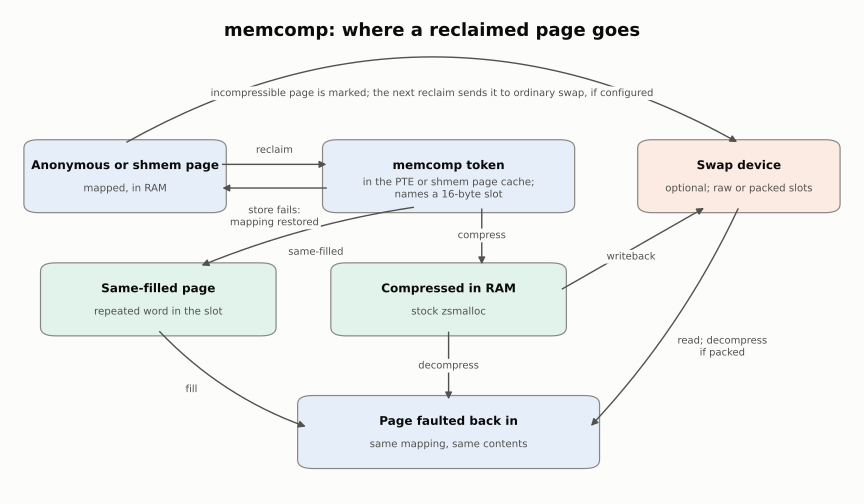
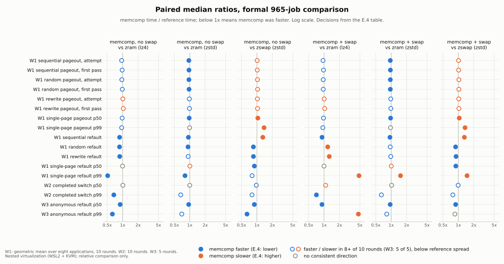
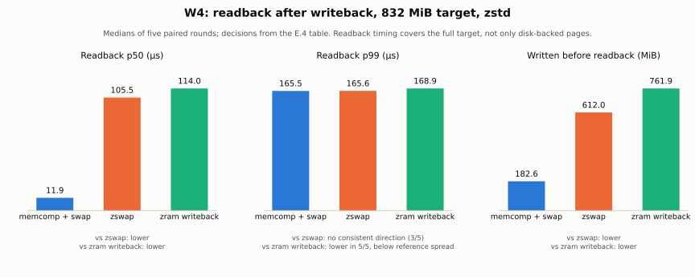

<!-- SPDX-License-Identifier: GPL-2.0-only OR CC-BY-4.0 -->
# memcomp: in-memory compression of reclaimed pages

**RFC series v1 for Linux 6.12.23.** The VM comparison in Section 3 is
complete: 965 fresh guest boots under nested virtualization, judged by a
paired rule fixed before collection. No phone results are reported,
because the variables on a phone could not be controlled; every number
comes from the KVM guests. Upstream submission is a separate step.

## Abstract

memcomp compresses reclaimed anonymous and shmem pages and keeps them in
memory. Reclaim replaces the page's PTE, or its shmem page-cache entry,
with a token that names a 16-byte slot. The slot points to the
compressed data or records a same-filled page. Once the data has been
written back, the slot points to a swap slot instead. A fault on the
token restores the page. The first storage layer needs no block device,
and real swap is optional.

memcomp uses the kernel's existing compressors and zsmalloc unchanged.
The series adds the backing store around them:
- token lifetime, and rollback when a store fails;
- charging compressed memory to the source memory cgroup;
- workingset feedback;
- moving entries from RAM to raw or packed swap slots.

In the formal VM comparison the clearest gains are in refault tail
latency without real swap. Single-page refault p99 was 10.7 µs for
memcomp against 20.7 µs for zram with lz4 (49% lower), and 22.0 µs
against 27.3 µs for zram with zstd (19% lower). Under 512 MiB of
anonymous pressure, refault p99 was 37% lower than zram with lz4 and 36%
lower than zswap. After writeback, readback p50 over an 832 MiB target
was 11.9 µs, against 105.5 µs for zswap and 114.0 µs for zram writeback,
and 70-76% fewer bytes were written before readback.

Some results go the other way. With real swap and lz4, single-page
refault p99 was 4.8 times zram's. Sequential refault was 30-31% slower
than zswap. Single-page pageout p99 was 35-38% slower than zswap. In
the measured W1 window, memcomp consumed 5-8% more memory than zram;
that window leaves out zram's fixed table, which here was larger than
the difference.
Section 3 reports every decision and Section 4 lists the unfavorable
ones.

## 1. Background and scope

zram is a compressed block device: swap writes pages to it as to any
disk. zswap is a cache in front of a swap device, and each of its
entries keeps the swap slot it came from. memcomp instead puts its own
entry type in the PTE. Its token does not belong to a swap device, so
the same token can point to RAM first and to a swap slot after
writeback, and the PTE does not change. memcomp still needs CONFIG_SWAP,
because it uses the swap-entry encoding and can write back to real swap.
Storing in memory needs no active swap device.

The series contains only the backing store and the VM hooks it needs. It
changes no compressor, crypto provider, allocator or reclaim policy, and
the evaluation credits none of their behavior to memcomp.

## 2. Design

*Figure 1. Where a reclaimed page goes and how a fault brings it back.*

### 2.1 Tokens and references

A token names an entry independently of the address that maps it. The
entry's state and its backing are protected separately from the PTEs
that refer to it. There are three kinds of reference:
- the owner reference covers the handoff from reclaim;
- lookup references protect concurrent operations;
- a resident reference keeps the original folio faultable while a failed
  store is undone.

Dropping the owner reference does not free backing that a PTE still
names.

The backing of a nonzero token is in one of five states:
- **pending:** the token still holds the source folio;
- **same-filled:** the entry keeps the repeated word and has no payload;
- **stored:** the payload is a zsmalloc object;
- **under writeback:** the RAM copy stays valid until the I/O completes
  and the state change is committed;
- **on swap:** the entry records whether its swap slot holds the raw
  page or a compressed payload that shares the slot with others.

memcomp handles fork, zap, migration, faults, smaps, madvise, shmem, HMM
and UFFDIO_MOVE. These pieces arrive across the series, so only the
complete series has the final behavior. The first patch is a separate
fix to the stock kernel: UFFDIO_MOVE checks that each page it moves is
exclusive.

### 2.2 Slot layout and metadata

Each nonzero token resolves to a 16-byte slot:
- a 64-bit backing word;
- a 32-bit reference count;
- a 16-bit encoded length;
- 16 bits of state and flags.

Slots come in clusters of 512, each split into eight 64-slot segments
that are allocated separately. The 16 bytes leave out cluster, key and
XArray metadata, per-store records and allocator overhead.

Allocation is grouped by a key: the object cgroup, the NUMA node,
anonymous or shmem, and a hint that the page may be zero. Each key has a
current cluster from which new tokens are reserved. A lookup goes from
the token through a cluster-ID XArray to the segment and then the slot.
The zero hint only chooses where a token is placed. It does not
establish the page's contents.

Tokens have their own namespace, separate from any swap device. One
token can therefore point to pool memory and later to a device, and no
mapping has to be rewritten. A design based on zswap or virtual swap
would give every entry a swap identity, with that identity's lifetime
rules. Mainline's newer swap table moves in a related direction and
could become an integration point after a rebase.

The slot is not the whole per-page cost:
- each allocated segment also has an array of eight-byte shadow words;
- each zsmalloc object has a handle;
- holes and unused segment capacity can push the shadow cost above eight
  bytes per live entry.

For comparison, take 64-bit with 4 KiB pages and no
ZRAM_TRACK_ENTRY_ACTIME. There, zram preallocates a 16-byte table entry
for every page of its disksize and keeps an eight-byte handle per
object; the tracking option makes the table entry larger. Swap metadata
comes on top in both cases.

Count only 24 bytes per allocated memcomp slot (the slot plus its
shadow word) against 16 bytes per page of zram disksize. The two are
then equal when memcomp holds two thirds of the disksize. This nominal
break-even is not a measured crossover. Shared metadata, allocation
granularity, handles, swap metadata, zero entries and real occupancy all
move it. Stock swap cache also keeps workingset shadows in its XArray,
so its shadow cost is not zero either. The density measurements in
Section 4 predate the shadow array.

Zero pages use token zero, which has no slot and no per-entry record.
Separate counts track how many anonymous PTEs and shmem entries hold it.
- **shmem:** an eligible order-0 page takes token zero before any slot
  is allocated.
- **Anonymous:** the page goes through the normal reserve-and-store path
  first. If a single-page store finds the page zero-filled, memcomp then
  tries to convert the matching PTEs to token zero.

The zero check uses the architecture's zero-page identity, and
conversion is best effort: PTEs that keep a positive token still have
valid backing. Other same-filled pages keep their slot and repeated
word.

A key's current cluster can become empty after partial use. Deferred
work frees such clusters. Each run looks at no more than 32 XArray
entries under the lock. A cluster that qualifies is marked on one visit
and detached on a later one, and a new reservation clears the mark.
Detached clusters are freed after an RCU grace period. The 32-entry
limit bounds the work per batch. It does not bound how long the lock is
held or how soon the memory is returned.

### 2.3 Store failure and mapping restoration

Reclaim takes a compression context and reserves tokens before it
replaces any present mapping. The store can still fail: compression,
accounting or allocation can fail, or the VM can race with it. memcomp
then walks the reverse map and puts the original PTEs back, much as
remove_migration_ptes() does after a failed migration. Each restored PTE
drops its token reference.

Two alternatives were rejected:
- leaving a reserved span that could be reused indefinitely;
- immediately rewriting the span as ordinary swap.

Restoring the mappings lets reclaim drop the attempt, and no later
access depends on a store that never finished.

memcomp pins the anon_vma while the folio is still mapped. After the
last unmap, nothing else may keep that structure alive, and the rollback
walk needs it. For a large folio, deferred_split_folio_remapped() clears
a stale partially_mapped flag and fixes the split-queue accounting once
every subpage is mapped again. Without this step, restoring the PTEs
would leave the deferred-split accounting wrong. A folio that really is
partly mapped keeps the flag.

References left after a walk come from fault lookups or from PTEs the
walk missed. memcomp walks again as long as each pass still restores
something, up to a fixed number of passes, so that VM activity cannot
make it retry forever. The limit is on the number of passes, not on the
cost of one walk. A pending token that escapes keeps its resident folio
until it is faulted or released, so it never points to a freed folio.

A failed store can therefore cost an unmap plus a reverse-map walk. That
can be expensive for widely shared folios in direct reclaim. Skipping
folios with a high mapcount is an open question that v1 does not
address.

### 2.4 Incompressible and same-filled pages

When compression returns -E2BIG, memcomp marks the folio incompressible.
The mark is stored in spare bits of folio->swap, together with a hash of
the contents; mainline has removed PG_error, so no page flag is reused.
- **Unchanged contents:** a marked folio is not compressed again.
- **Changed contents:** the hash no longer matches, so the page is tried
  again.
- **Split folios:** a split changes how the bits are read, so the
  children do not inherit the mark.

An incompressible page therefore takes two reclaims:
1. The first reclaim pays for a failed compression, marks the page and
   leaves it in RAM.
2. The second reclaim skips compression and sends the page to real
   swap, if there is any.

zswap sends a page it cannot compress to swap during the same reclaim.
So that the second step is not counted as first-pass work, W1 reports
how much the first pass completed. It also gives pageout time with both
denominators.

A same-filled page is stored as its repeated word in the entry. It still
needs entry metadata and reference counting. Logical bytes divided by
payload bytes therefore overstates the physical memory saved.

### 2.5 Raw and packed swap backing

With real swap configured, reclaim can fall back to ordinary swap before
memcomp takes ownership, and memcomp can write cold payloads to the
device.

Folios already in swap cache are handled as follows:
- **Dirty anonymous folio:** it gives up its swap slot so that its new
  contents can be compressed again, as zswap also does. "Dirty" includes
  writes still recorded only in the PTEs or PMDs before unmap.
- **Clean folio:** it is dropped as usual. If other swap references keep
  it, ordinary swap handles it.
- **Clean mapped folio:** confirming that it is clean can need a
  read-only reverse-map walk, so this path is not free.

Writeback admission uses two controls. A watermark derived from total
RAM opens the gate, and a feedback setpoint on the physical pool size
regulates the rate. The watermark reserves no memory and assumes no
device size.

Writeback is driven by reclaim. Each reclaim cycle grants a finite
quota, and the worker stops when that quota is used. It does not drain
the pool until the gate closes. After pressure ends, the pool can stay
above the writeback start point, with the gate still open, until the
next reclaim. memcomp does not write to disk while memory is idle, so an
open gate does not mean writeback is in progress.

Each entry records which backing form it uses and its offset:
- **Packed slot:** compressed payloads that can profitably share a swap
  page are packed together.
- **Raw slot:** the rest take a raw page-sized slot.

Raw-only backing would give up the space and write savings for
compressible data. Packed-only backing would add overhead for data that
does not compress enough.

The following work without changing zsmalloc:
- packed-slot ownership;
- caching of the sibling payloads read with a slot;
- prefetch;
- conservative defragmentation of a slot with a single surviving
  payload.

Allocation and I/O happen outside sections that hold a non-reclaimable
entry lock. A swap slot is freed only after every reference that
protects its contents is resolved.

swapoff moves the affected payloads from the device back into the
compressed pool. PTEs and shmem entries keep naming the same tokens. No
user page is built, no shadow is consumed, and the source identity is
unchanged; the user's next access does the refault. zswap entries, by
contrast, keep their swap-device identity, so swapoff has to read them
into user pages.

swapoff can return an error, and can then be retried, in these cases:
- moving a payload back fails because allocation or charging fails;
- device I/O fails;
- another writeback pass hits an I/O error while swapoff has dropped its
  lock.

Transport slots are the swap slots that carry memcomp payloads. They are
marked in a per-device bitmap indexed by offset rather than by a folio
flag, because ordinary swap readahead can also bring such a slot into
swap cache. Evicting a transport folio creates no workingset shadow, and
reading one is not counted a second time as a user swapin. The bit is
cleared when the slot is finally freed, before it can be reused.

### 2.6 Synchronous and asynchronous compression

Synchronous compression contexts are a bounded resource. Reclaim takes
one before the unmap-and-store handoff and returns it before rolling
back or finishing the folio.

The async pool is created only if the chosen compressor already has a
registered CRYPTO_ALG_ASYNC acomp implementation. The lookup uses
CRYPTO_NOLOAD and never loads a provider, and the request and buffer
allocations must yield a usable batch.

Reclaim uses the async path only while memcomp is enabled and a free
batch is available. It then processes a bounded foreground batch, with
one request per page. Requests, buffers, snapshots and completion state
stay allocated until the batch drains. A batch that hit an error is not
recycled as if it had completed.

The presence of the async path does not mean that a compressor runs
asynchronously. The stock compressors used in the VM comparison are
synchronous, so the synchronous path is the one that was measured. KUnit
registers its own async provider to test completion and failure. Those
tests do not show hardware acceleration on a device.

### 2.7 Source memory-cgroup accounting

Slot-table metadata and payloads are charged to the source folio's
object cgroup, not to whichever task runs reclaim. A payload charge goes
through three steps:
1. It is reserved outside the token lock.
2. It is committed when the backing is published.
3. It is refunded if publication fails.

Metadata and ownership are released at their own lifetime boundaries;
releasing a slot does not mean that shared backing is freed at once.

Writeback refunds the RAM payload charge, and swapoff charges it again
before returning the entry to RAM. memcomp also pins the source memcg ID
separately, and that ID survives reparenting of the object cgroup. When
the user loads an anonymous or shmem page, the new folio is charged to
the source memcg if it is online. Otherwise it is charged to the
reader's memcg, as swapin does. This is accounting only. memcomp adds no
memory limit, per-cgroup writeback target or controller of its own.

### 2.8 Workingset feedback and residency

When a page is stored, memcomp publishes the stock workingset shadow
only after the last step that can fail. Until then, a publication gate
keeps readers and background transitions out.

On a user load, the steps are:
1. Charge the new folio.
2. Claim and clear the shadow under the slot lock.
3. Drop the lock and run stock workingset refault processing.
4. Read the page and map it.

A consumed shadow is not put back if the read fails, is retried or loses
an installation race. A second reader of the same token therefore
cannot consume it again. For a large folio, the first base page's
shadow supplies the feedback and all member shadows are cleared.

Faults are counted as follows:
- **Major fault:** bringing back a nonresident memcomp page for a user,
  including same-filled and swap-backed entries. On shmem this applies
  when the call has a fault context. On the anonymous path the count
  stays even if a later PTE installation race is lost.
- **Minor fault:** resident and zero tokens.

The read is accounted as swapin delay. It also counts as memory PSI and
thrashing when the folio is marked workingset. Transport reads are not
counted as a second user refault. Zero tokens have no shadow or source
ID and are always restored as single pages.

mincore reports zero, resident, pending, same-filled and pool-backed
entries as resident. A swap-backed entry is resident only when its
swap-cache folio is present and up to date. The query starts no I/O or
readahead.

## 3. Evaluation

The formal comparison ran 965 fresh guest boots on real application
pages. All 965 slots completed with valid records and no extraction
failure. Early tests used generated page contents; their performance
results are withdrawn and are not used here.

### Captured data and privacy

The input is resident anonymous memory captured from eight Android
processes:
- system_server and SystemUI;
- QQ and WeChat;
- Chrome;
- NetEase Cloud Music;
- Discord and Telegram.

Capture is not atomic. PFN observations do not show that the pages were
resident at the same time or that they are unique. Source order, zero
pages and same-filled pages are kept as captured. Raw pages and per-page
classifications stay private. Only aggregate counts, input hashes and
descriptive distributions are published.

Each guest reads the same read-only corpus disk with O_DIRECT. Pages are
selected as follows:
- W1 samples page indices uniformly within each application's pages.
- In W2 each worker has its own source.
- Combined workloads use the recorded order of sources.
- Rewrite priming and pressure take indices from outside the target set,
  so they never overlap it.

If there is not enough data, the job fails; pages are not repeated,
generated or dropped to make the workload fit. Per-page hashes verify
the contents outside the timed first-byte reads. Offline codec
statistics show neither which backing form the kernel chose for a page
nor which pages were written back.

### Configurations and collection

All kernels are Linux 6.12.23 with stock compressors and zsmalloc. The
ten groups are:
- plain swap;
- zram with zstd, and zram with lz4;
- zram writeback with zstd;
- zswap with zstd;
- memcomp with zstd and with lz4, each with and without real swap
  (four groups);
- as an environment check, the series tree built with MEMCOMP=n and
  running zswap.

The memcomp kernels enable CONFIG_MEMCOMP_DEBUG_STATS, whose counters add
atomic operations; they are part of the measured configuration.

The measured mainline-series source tree is
4a25cd2f2b176663e3b3323dbf307c8842ad1713. Reference kernels use the
same prerequisite layer without the memcomp series. Series v1 has tree
06b510f011f66cb14e8a5dd4d00d72a3a1a0a7a5. It differs from the measured
tree only by the rename of the sysfs directory and by seven removed
header-comment lines. The rename touched:
- the directory name string;
- the ABI document's file name and paths;
- the admin guide;
- one MAINTAINERS entry;
- one comment;
- the selftest's sysfs path.

The frozen collection tools therefore read the earlier directory name.
The published copies of those tools read /sys/kernel/mm/memcomp.

Each guest has:
- two vCPUs and 1024 MiB of RAM;
- 2048 MiB of swap or zram backing where the group uses one;
- a separate 128 MiB raw disk for results.

The measured task runs on guest CPU 1, and the QEMU and vCPU threads are
pinned to host CPUs 4-7. MGLRU is enabled and its boot mask is
recorded. Nothing else runs on the host during collection: no
compilation, no other VM and no randconfig build. Each launch records
the one-minute load average and waits while it is above 1.0.

Each job boots a fresh guest with fresh sparse backing. The backend
order rotates with each outer round and is reversed in even rounds. The
jobs add up to 965:

| Workload | Groups | Outer rounds | Jobs |
| --- | ---: | ---: | ---: |
| W1 (8 source applications) | 10 | 10 | 800 |
| W2 | 10 | 10 | 100 |
| W3 | 10 | 5 | 50 |
| W4 | 3 (writeback groups) | 5 | 15 |

Integration smoke and canary runs are excluded.

A workload failure or timeout stays in its slot and is not retried. For
host interruptions the rules were:
- Keep only complete outer rounds. Keep the interrupted round's files,
  marked invalid.
- Restart that round and all later ones in a new root, at most three
  times. Each round comes from exactly one root.
- Report each segment's rounds, times, boot identity and gaps, with
  crosscheck ratios per segment.

No continuation was needed. The collection ran as one segment, rounds
1-10, from 2026-11-11 03:39 UTC to 2026-11-13 01:47 UTC.

Large CSV records and snapshots go to the raw result disk. The serial
console carries only phase markers, kernel messages and the length and
hash of the data, which the host checks. Console output is drained
before each timed phase, so serial transfer is not timed as workload.
The swap backing uses cache=unsafe. Disk refault therefore reflects the
host page cache, not the latency of physical storage.

### Workloads

- **W1** loads 16384 real pages (64 MiB) per application.
  - Each fresh mapping runs sequential, random, single-page and rewrite
    paths, with one warmup and five measured inner rounds.
  - Single-page sampling covers 4096 pages.
  - Rewrite first primes the region with a separate slice of data, then
    overwrites it with the target contents.
  - Initial pageout, drain and retry are timed separately.
- **W2** runs eight workers of 64 MiB each under memory.max=256 MiB,
  with memory.swap.max unlimited.
  - It asks for 32 switches, each with a 10-second timeout.
  - A switch has two steps. A first-byte traversal ends before the
    timing ACK, and a full content check follows after a separate
    go-ahead.
  - A switch counts as completed only if both steps match.
  - W2 reports the distribution over completed switches, together with
    survival and failed switches.
- **W3** has a 512 MiB private anonymous target and 512 MiB of separate
  real pressure data. Older tmpfs and generated-data variants are
  functional tests, not part of this workload.
- **W4** has an 832 MiB target.
  - Held pressure is seven eighths of guest RAM.
  - A temporary ramp adds another quarter and is released before
    pressure_ready.
  - Held pages stay in place through readback and full verification.
  - Pressure and data selection are identical for the three backends.
  - zram writeback also uses explicit idle writeback. That difference in
    policy is part of the comparison.

### Pageout, readback and memory denominators

W1 reports pageout time with two denominators:
- requested pages;
- pages that were nonpresent after the first pass, read from pagemap
  right after the timed PAGEOUT and before drain or retries.

The completion fraction and the later drain and retry work are reported
separately, and a zero denominator is undefined. Each pair uses one
denominator, and both columns are kept:
- memcomp without swap against zram uses requested pages;
- memcomp with swap against zswap uses first-pass nonpresent pages.

Totals are not rebuilt from rounded means.

Pages are classified for readback after drain and before the first
read:
- **Counted as a refault:** a nonpresent memcomp entry, or a real-swap
  entry that was not in swap cache at that moment.
- **Readahead:** pages brought in by readahead during the traversal stay
  in that population and are also reported on their own.
- **Already in swap cache:** counted separately. A cache hit is not
  reported as a disk refault.

W3 uses the same classification. Statistics on nonpresent first touches
are descriptive.

The W1 memory window runs from before a fresh sequential fill to after
drain. It reports MemFree plus free pages taken from the per-CPU lists,
and the backend's physical pool pages. Logical bytes and codec ratios
are separate quantities. The accounting follows these rules:
- Memory a backend allocates at setup is measured in a separate window,
  against a baseline taken before setup, and is not part of the W1
  figure.
- Named slab caches are part of global Slab and are not added a second
  time.
- Fixed metadata sized by the device, dynamic metadata, pool pages and
  unexplained global changes are kept apart.
- A balanced global snapshot does not show which component owns what.
- Negative releases and absolute endpoints are kept.

The metadata density figures in Section 4 come from a separate
accounting experiment and are not whole-memory results of this matrix.

### W4 writeback window and stability

Each backend must show a positive increase in its own writeback counter
between pressure_begin and read_begin:
- vmstat zswpwb for zswap;
- packed_swap_events.writeback_payloads for memcomp;
- bd_writes for zram writeback.

These counters show that writeback happened. They count different units
and say nothing about individual target pages.

Before readback, the host waits until the writeback counter and pgscan
stay unchanged for three consecutive one-second intervals, for up to 300
seconds. memcomp's admission gate is only recorded, because an open gate
does not mean I/O is active. A slot that never settles keeps its write
volume, but its readback latency is left out of the comparison. It is
not rerun.

Write volume is the swap disk's increase in written sectors over the
same window, multiplied by 512. Writes between read_begin and read_end
are reported separately.

Readback p50 and p99 cover verified first touches of the whole target
after writeback has settled. They are reported with read-source counts:
- pages read from the pool, from disk, or brought in with a sibling,
  with page counts and p50/p99 where they can be attributed;
- counters for the pages that cannot be attributed;
- retrievals, cache-hit ratio, disk reads, pages per read and the
  repeated-read lower bound.

The readback figures are not the latency of pages proven to have been
written to disk, and they cannot show a per-read speedup. Writes before
readback are not used as a denominator for read amplification, because
writeback can continue during the reads.

### Paired decisions and environment check

Each boot's measured inner rounds are reduced to one median. Each
comparison reports the outer-round medians, the IQR and the reference
spread, (maximum − minimum)/median. Candidate and reference observations
are paired within the same outer round.

A row is called lower or higher only if all three conditions hold:
- every pair is complete;
- at least 8 of 10 pairs point the same way, or 5 of 5 for five-round
  workloads;
- the median ratio differs from one by more than the reference spread.

Otherwise the row keeps the frozen summary's classification: within
noise, incomplete or descriptive. No subset is chosen after the fact.

A complete row that meets the second condition but not the third is
reported with its direction and its round count, whichever way it
points. Its difference is smaller than the reference's own variation
between rounds, so its size is less certain than its direction. A
two-sided sign test gives p = 0.002 for 10 of 10 pairs, 0.021 for 9 of
10, 0.11 for 8 of 10 and 0.063 for 5 of 5. The decision table keeps
these rows' frozen classification, within_noise.

Combined W1 timing works the same way. Within each outer round it takes
the geometric mean of the eight applications' ratios, then applies the
rule across the ten rounds. Each application is also reported on its
own.

A counter ratio is given a direction only if the reference increases in
every round. The reference median must also reach a minimum:
- 1 ms for PSI;
- 100 events for event counters;
- 1 MiB for byte and sector counts.

Below that, only the absolute medians are reported.

For pairs that include memcomp, the counters are treated as follows:
- **No direction:** pswpin, pswpout, zswpin, zswpout and zswpwb, because
  memcomp counts these differently or not at all.
- **Paired rule, with the minimums above:** PSI and pgmajfault.
- **Read-source table only:** workingset counters.
- **Paired rule:** memory PSI from reclaim alone, I/O and CPU PSI,
  pgscan, allocstall and diskstats.

I/O volume across backends always comes from diskstats, never from
backend-specific counters. The crosscheck pair keeps its original rule.

The environment check compares the primary timings of the MEMCOMP=n
crosscheck with stock zswap; its counters are descriptive. It requires
complete valid pairs and a within-noise decision; any other outcome
would block a performance claim. The crosscheck's object code was
checked for equivalence separately before collection. The decision
table (E4-presentation-table.csv under results/) was generated once,
after all slots had been collected. This paper and its figures use that
table, unfavorable rows included.

### Rules changed after data was seen

The following rules changed after some data had been seen.

- **Environment check:** its definition was clarified after an earlier
  collection with generated page contents. Ten crosscheck-versus-
  reference rows had been seen, but no candidate direction. That run's
  original "unknown" decision and its rows remain in the results; its
  performance data is not used.
- **Migration category:** reclassified after collection because that
  entry type comes from stock migration, not from memcomp. Its original
  failed decision stays in the historical record.
- **Second W1 pageout denominator:** added after candidate data had been
  seen, to separate first-pass completion from later drain and retry.
  Both denominators are reported, each under the unchanged paired rule.
- **Snapshot protocol v2:** defined after one cohort was marked invalid,
  and before that cohort had run any memcomp backend. Its records showed
  Buffers rising by 64 KiB per snapshot. They also showed a difference
  of about one per-CPU batch between MemFree and the buddy free pages.
  The residual threshold was not changed.
- **Missing kernel accounting:** an earlier residual exposed a kernel
  allocation that was not accounted. The kernel was fixed and the
  collection restarted from the beginning, with the same threshold and
  collector.
- **Refault accounting:** before the formal collection, a memcomp user
  load was changed to count memory PSI, a major fault and a workingset
  refault, as a swapin does (Section 2.8). No collection from before
  that change is used here.
- **Counters memcomp accounts differently:** the presentation rule for
  them was added on 2026-11-10, after interim data from an earlier
  real-corpus run had been examined. Both sides' values are kept, under
  the counter rules above. That earlier run stopped at guest 335 and
  produced no formal decision or environment check; none of its numbers
  appear here.
- **Canary denominator:** the canary's accounting denominator now leaves
  out zero-filled token pages, which count as neither major faults nor
  refaults. This affects only the canary, not the decisions, the corpus
  or the workloads.
- **Direction for rows below the spread:** added on 2026-11-14, after
  all results had been seen. It applies to every complete row that
  meets the consistency condition, in both directions: in Figure 2,
  memcomp was lower in 28 such rows and higher in 19. No decision in
  the table changed.

### Results

**Environment check.** All 84 primary timings of the MEMCOMP=n zswap
crosscheck were within noise against stock zswap, with complete pairs.
The environment decision is therefore within noise, and the comparisons
below can carry directional decisions.

Figure 2 shows every primary timing in the six memcomp pairs.
[evaluation-tables.md](evaluation-tables.md) gives each row's absolute
medians, ratio, consistency count, direction and E.4 decision.

*Figure 2. Paired median ratio of memcomp time to reference time. Filled
blue: lower (memcomp faster). Filled orange: higher (memcomp slower).
Hollow blue or orange: the same direction in at least 8 of 10 pairs (5
of 5 for W3), with a difference smaller than the reference spread.
Hollow gray: no consistent direction. W1 rows use the per-round
geometric mean over the eight applications.*

Below, a difference given without a round count met all three
conditions. One given with a round count, such as "lower in 10/10
rounds", met the first two only. The largest of these are tail
latencies: memcomp was 18-36% lower in at least 9 of 10 rounds, or in 5
of 5, for single-page refault p99 against zswap, completed-switch p99
with zstd against both references, and W3 refault p99 against zram with
zstd. The others differ by 0.5-7.5%.

**Refault without real swap.** Single-page refault p99 was lower than
zram: 10.70 against 20.70 µs with lz4 (ratio 0.511) and 21.97 against
27.28 µs with zstd (0.807). Against zswap it was 19% lower in 10/10
rounds (ratio 0.806). Single-page refault p50 was 10.8% lower than zswap
(9.87 against 11.07 µs), 0.6% higher than zram with zstd in 9/10 rounds,
and had no consistent direction against zram with lz4. Sequential,
random and rewrite refault were 6-13% lower than zram; rewrite refault
with zstd, 6.9% lower, was lower in 10/10 rounds. Random and rewrite
refault were about 15% lower than zswap.
Sequential refault was 30% higher than zswap (9.55 against 7.30 µs).

**Refault with real swap.** With zstd, single-page refault p99 was 41.03
µs, against 27.28 µs for zram (ratio 1.520) and 27.43 µs for zswap
(1.480); both rows are higher. With lz4 it was 99.54 µs against 20.70 µs
for zram (4.800). Random and rewrite refault with lz4 were 18% and 26%
higher than zram. With zstd they were 4.3% and 2.1% lower than zram in
10/10 rounds, and 12% and 10% lower than zswap. Sequential refault was 9% (lz4) and 5% (zstd)
lower than zram and 31% higher than zswap. Single-page refault p50 was
0.5% higher than zram with zstd in 10/10 rounds and had no consistent
direction against zram with lz4.

**Pageout.** Against zram with zstd, sequential and random pageout were
3-4% lower and single-page pageout p50 was 2.7% lower; rewrite pageout
was 1.5-2.0% lower in 10/10 rounds. Against zram with lz4, sequential
and random pageout were 1.5-4.4% lower and single-page pageout p50 and
p99 were 2.1-5.5% lower, in at least 9 of 10 rounds; rewrite pageout was
0.7-3.1% higher in at least 9 of 10. Against zswap, sequential, random
and rewrite pageout were 1.0-3.1% higher in 10/10 rounds, single-page
pageout p50 was 4.2% higher and p99 35-38% higher (63.57 and 61.69
against 45.80 µs). Single-page pageout p99 had no consistent direction
against zram with zstd.

**Switching (W2).** Every worker survived in every group and round:
eight of eight alive before cleanup, availability 1.00. Completed-switch
p50 had no consistent direction in three pairs. Against zswap it was
2.7% lower without swap (9/10 rounds) and 0.8% lower with swap (8/10);
with swap it was 7.5% higher than zram with lz4 (10/10). Completed-switch
p99 was lower than zram with lz4: 112.6 against 170.2 ms without swap
(ratio 0.673) and 114.8 ms with swap (0.710). With zstd it was 33-36%
lower than zram in 10/10 rounds and 20-22% lower than zswap in 9/10
rounds (ratios 0.645-0.804).

**Anonymous pressure (W3).** Refault p50 was 4-11% lower in all six
pairs. Without swap, refault p99 was lower than zram with lz4 (15.86
against 25.14 µs, ratio 0.631) and than zswap (24.58 against 40.31 µs,
0.641), and 30% lower than zram with zstd in 5/5 rounds (0.698). With
swap and zstd, p99 was 18% lower than zram in 5/5 rounds and had no
consistent direction against zswap (lower in 4/5). With
swap and lz4, p99 was 117.6 against 25.14 µs (4.672), higher.

**Writeback and readback (W4).** Figure 3 compares memcomp with swap,
zswap and zram writeback, all with zstd, after writeback had settled.

*Figure 3. Medians of five paired rounds. Readback timing covers verified
first touches of the whole 832 MiB target from mixed sources; it is not
the latency of disk-backed pages alone.*

Readback p50 was 11.9 µs, against 105.5 µs for zswap and 114.0 µs for
zram writeback. Readback p99 was nearly the same
for all three: 165.5, 165.6 and 168.9 µs. It was 2.5% lower than zram
writeback in 5/5 rounds and had no consistent direction against zswap. Before readback, memcomp wrote
182.6 MiB to the swap device, against 612.0 MiB for zswap and 761.9 MiB
for zram writeback (70% and 76% less). memcomp packs compressed payloads
into shared swap slots, while zswap writeback and zram writeback write
full pages; this is consistent with the difference but was not measured
separately. During readback memcomp wrote another 91.6 MiB, zswap 221.0
MiB and zram writeback nothing. zram writeback also used explicit idle
writeback, which is part of its configuration.

Read sources cannot be separated per page. In every round, 212201 of the
212992 target pages were memcomp entries in the snapshot taken before
readback; that cohort mixes pool-resident and written-back entries.
During readback, memcomp retrieved written-back payloads 165248-172652
times through read I/O and 85268-88397 times from cache (33.7-34.1%
from cache). It issued 80607-85011 disk read requests per round, against
137863-163704 for zswap and 195038 for zram writeback. The per-round
values are in the W4 source split under results/.

**Memory (W1, descriptive).** Physical memory consumed in the W1 memory
window, with 64 MiB loaded per application, is not part of the E.4
decisions. Across applications, the median memcomp-to-reference ratio
was 1.053 against zram with lz4 (range 1.050-1.059), 1.079 against zram
with zstd (1.066-1.095) and 0.967 against zswap (0.959-0.988); with swap
and zstd it was 0.952 against zswap. memcomp therefore used 5-8% more
memory than zram and 3-5% less than zswap in this window. The window
includes pages left resident after the first pageout pass: a median
1.95% of the pages with lz4 and 0.56% with zstd (per-application ranges
1.07-3.72% and 0.01-1.32%). zram stores such pages uncompressed and left
none resident. This does not attribute the whole difference.

In absolute terms, memcomp without swap used 1.05-1.55 MiB more than
zram per application (median of the paired per-round differences). The
W1 window starts after backend setup, so it leaves out memory that a
backend allocates once for its configured size. That cost was measured
separately, from before backend setup to the start of the workload.
With zram's 2048 MiB disksize, VmallocUsed grew by 8780 KiB with lz4 and
9108 KiB with zstd, the same in all 80 boots of each group. Of this,
8192 KiB is the table: 524288 entries of 16 bytes. memcomp without swap
allocated no vmalloc memory during setup. With swap, memcomp and zswap
each grew VmallocUsed by 516 KiB for the swap device. Counting setup,
memcomp without swap therefore used less memory than zram in this
configuration. The fixed cost scales with the chosen disksize, here
twice the guest's RAM, so the comparison depends on that choice. The
setup figures come from the guests' raw /proc/meminfo snapshots; the
script and its per-group output are under results/.

### No phone evaluation

This RFC reports no phone results. A phone comparison could not hold
the other variables fixed: Android's low-memory killer takes free swap
into account, app behavior and kill decisions vary from boot to boot,
and thermal and frequency state drift during a run. A difference
measured under those conditions could not be attributed to the kernel
change, so every number in this paper comes from the KVM guests above.

The release ACK Image, the Images for an A/B pair (arm A with memcomp,
arm B with stock zram) and the AArch64 userspace tools in device/ were
built on the host and passed the recorded build and object checks.
These checks say nothing about Android compatibility or device
performance.

## 4. Known issues and limits

### Metadata density

One 512 MiB sample of the combined corpus, taken at r0_seq_read_begin,
recorded 1960552 bytes of metadata for 119529 stored payload pages. That
is 16.40 bytes per page. The denominator is stored pages, not the 131072
pages of the workload. The sample's content checks passed, teardown took
451 ms, and the owner charges and gauges returned to zero. It is a
single sample, not a physical-memory result of the formal matrix.

An earlier cohort recorded the same 1960552 bytes for 119529 pages in
its combined sample. That is about 0.1 byte per page below the 16.5
B/page threshold set for the combined sample. The cohort's sixteen
single-application jobs measured 16.45-16.78 B/page, and twelve of them
were above 16.5. The threshold was not applied to them, and their
stored-page counts differ by application. That cohort ran an
instrumented image built on tree
dd125cdd5d1acb778f8297af3604c2833288b229; its ledger is
results/2026-11-01-v454-full-r2/fragmentation-report.json. It predates
the metadata-shrinker fix and the accounting and workingset changes.

The combined sample above and the aging measurements below were both
taken on tree 3967c68dc3b5876e30d1c8ca224101e5686668f4. Each experiment
used its own observer instrumentation, in a separate image. XArray node
and operation budgets and the density assertions were measured on that
instrumented source.

Series v1 (tree 06b510f011f66cb14e8a5dd4d00d72a3a1a0a7a5) keeps the
32-entry batch. Since tree 3967c68d it has had these changes:
- the diagnostic instrumentation was removed;
- the source was reorganized and renamed, and the style was cleaned up;
- the metadata shrinker's exit when it makes no progress was fixed;
- the accounting, source-ID, workingset and mincore changes were added;
- the sysfs directory was renamed.

The cleanup was checked with a classified source diff and mutation
replays. The measurements were not repeated on the release tree. The
density figures also predate the shadow array (Section 2.2).

### Aging: lock hold times

These measurements use the same tree 3967c68d with an aging probe. Each
scenario completed 61 full scans on the first attempt, with no retry, at
most 32 raw XArray entries per batch and no change in steal time.

In the table, times are in microseconds:
- "Records" is the collector's all_records count. It is neither the
  number of lock acquisitions nor the sum of first and later batches.
- The overall maxima include baseline records.

| Scenario | Records | First batch median / max | Later batches median / max | Overall p99 | Overall max |
| --- | ---: | ---: | ---: | ---: | ---: |
| combined | 497 | 1.91 / 12.6 | 0.54 / 10.1 | 12.2 | 12.6 |
| many (2000 memory cgroups) | 4134 | 30.7 / 72.9 | 1.93 / 73.8 | 35.5 | 73.8 |
| many-clusters-per-key | 305 | 1.36 / 19.5 | 0.65 / 57.3 | 12.1 | 57.3 |

With 64-entry batches, two combined runs reached maxima of 130.9 and
146.2 µs, which is why the batch is 32. The 64-entry image was built on
tree 8ed81fa430cc56bcb531c29641fced070c068ae4. A later tree,
21bf6d420242df8f8dd372c248a4eb6c2e94fe06, differed only in test files
that the measured configuration does not build.

These runs used nested virtualization under WSL2, so there is no device
timing. The tail latency was not investigated. In the many and
many-clusters-per-key scenarios the maxima came in later batches, so the
data does not support blaming the first batch or a cold cache. The
acceptance thresholds were revised after the data had been seen. The
maxima are observations, not a worst case; limiting the entries per
batch does not limit the time spent waiting for or holding the lock.

### Other implementation limits

- A failed store can cost both the unmap and the reverse-map restore.
  There is no bound on worst-case response time.
- The bounded re-walk can miss a PTE. The token then keeps its resident
  folio until a later fault or release; restore_missed_pages counts
  these.
- The incompressible mark depends on the token width and does not
  survive a folio split.
- KSM pages go to ordinary swap; memcomp does not store them.
- There is no memcomp-specific memory-cgroup limit and no writeback
  directed at a particular owner.
- Zero tokens keep no owner ID or workingset shadow. They are counted
  per PTE, not charged to a memcg as compressed backing. Nonzero
  same-filled entries keep normal entry metadata.
- Under extreme memory pressure, fork can return ENOMEM.
- Metadata reclaim uses a cluster FIFO with a second chance, and
  metadata is charged per cluster rather than per token.
- The last reference frees the payload; there is no DEAD state or
  garbage-collection worker.
- The async path needs a matching async crypto provider. Whether one
  exists has to be checked on each system.
- Hibernation, memory hot-remove, DAMON and khugepaged interactions have
  had static review only; their runtime behavior is untested.

### Dirty check on clean mapped swap-cache folios

Before a reusable swap slot is released, a read-only reverse-map walk may
be needed to find dirty PTEs, so clean pages do not get a free fast
path. The earlier timing of this walk used generated contents and is
withdrawn with the other synthetic results. Making the check cheaper
would be a separate change to the generic rmap code.

### Results less favorable to memcomp

[evaluation-tables.md](evaluation-tables.md) lists every row the paired
rule judged higher, 249 in all, including per-application and counter
rows. The main ones:

- With real swap, single-page refault p99 was higher than both
  references: 4.800 times zram with lz4, and 1.520 times zram and 1.480
  times zswap with zstd. W3 refault p99 with swap and lz4 was 4.672 times
  zram. Random and rewrite refault with swap and lz4 were 18% and 26%
  higher than zram.
- Sequential refault was 30-31% slower than zswap over the eight
  applications combined, with and without swap, and slower in each
  application (26-33%). memcomp has no swap readahead, as zram has
  none; v1 does not address this.
- Single-page pageout was slower than zswap: p50 by 4.2% and p99 by
  35-38%. The cause was not investigated.
- Counter rows: in W1, memory PSI during readback was higher than zram
  with lz4 for memcomp with swap in 21 application and phase rows per
  PSI metric, and CPU PSI was higher in some rows against every
  reference. W3 memory PSI with swap and lz4 and two W2 disk-volume rows
  against zswap were also higher.
- W1 consumed 5-8% more memory than zram (descriptive, Section 3).
  This excludes zram's fixed table, which with the 2048 MiB disksize
  used here was larger than the difference.

With real swap, memcomp handles an incompressible page in two steps
(Section 2.4). The first reclaim fails compression and leaves the page
in RAM; a later reclaim sends it to swap, and a refault then reads the
disk. zram keeps such pages uncompressed in memory, and zswap sends them
to swap during the first reclaim. In W1 a median 1.95% (lz4) and 0.56%
(zstd) of the pages stayed resident after the first pass; with swap, a
median 319 and 92 pages per application became nonpresent only during
the later drain. This fits the higher tails with swap, and with lz4
more than zstd. It is a reading of the design, not a measurement of
where each slow sample came from: why each page was first rejected, and
the remaining slow samples, were not traced.

### Limits of the evidence

All comparison data come from one host running WSL2 with nested KVM.
They support relative comparison between backends, not device latency,
energy use or capacity, and no phone results are included. The virtual
disk used cache=unsafe, so disk refault reflects host page-cache speed
rather than physical storage.
The memcomp kernels enabled CONFIG_MEMCOMP_DEBUG_STATS, whose counters
add atomic operations. The comparison does not cover MTE-enabled arm64,
other compressors or other zsmalloc settings.

### Future work

A 10-byte-per-page entry layout was tried and dropped because pageout
became much slower. A zsmalloc interface for caller-private metadata, if
one is wanted, belongs in a separate generic series.

## 5. Gap to an upstream submission

The series is based on an LTS kernel, not mm-unstable. Mainline has
since added swap-table interfaces and removed zpool, so a rebase is
needed before submission. The ACK branch is for building Android images,
not an upstream base. memcomp cannot run together with zram or zswap. Its
encoding uses one swap type, and it supports only 64-bit
configurations.

The following need upstream review:
- the source and patch layout: the implementation is one compilation
  unit with internal headers split by function;
- the multivalue sysfs ABI;
- the debug counters.

v1 keeps the KUnit probes in production code. Moving them to static
stubs or the fault-injection framework is left for later. Mainline x86
sparse was run with LLVM and GCC; ACK and arm64 sparse and arm64 W=1
were not. The paths without an exact test include swapon unwind and
retry after a bitmap allocation failure, a genuine shmem charge failure
as distinct from an earlier allocation failure, zero-page refault
windows attributable to one operation, two concurrent readers of one
token, a pool return followed by its first consumption, and ordinary
reuse of the same swap offset. The error path for a failed pin of a
still-online source memory cgroup is defensive and was never reached at
runtime. The series was written with AI assistance and was reviewed
and signed off by the maintainer.

## 6. Reproduction and related work

The [repository README](../README.md) lists the patch series, the ACK
branch, the device images and the commands that rerun the tests and the
comparison. The boot option is memcomp.compressor= and the sysfs
directory is /sys/kernel/mm/memcomp/. Configuration and ABI details are
in Documentation/mm/memcomp.rst and Documentation/admin-guide/mm/memcomp.rst
in the kernel tree. Run the pressure and swapoff tests only in
disposable VMs. The ordinary selftest does not change the host's swap
setup unless it is explicitly told to.

zram, zswap, KUnit and the MM subsystem are documented in the kernel
tree. The comparison runs zram and zswap as they ship, not as weakened
baselines. The results are paired comparisons in one environment and do
not make any backend a general winner.
